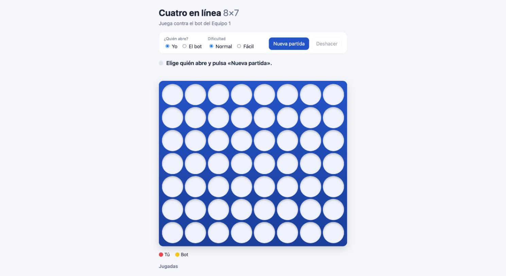
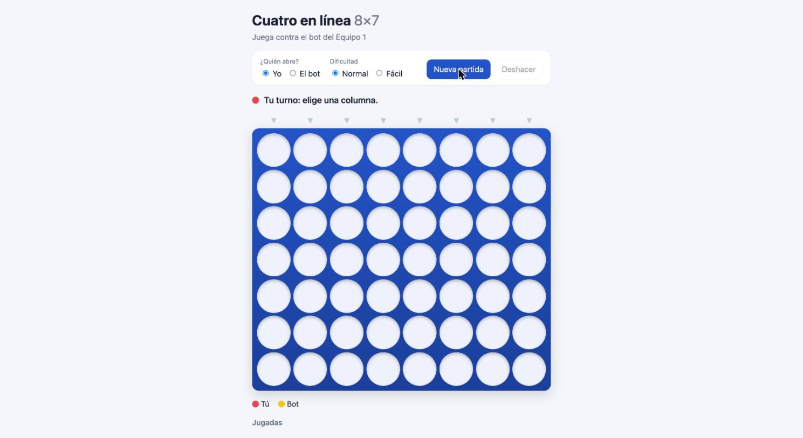
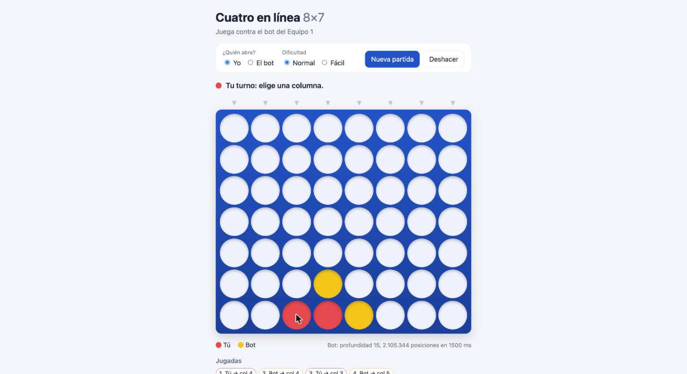
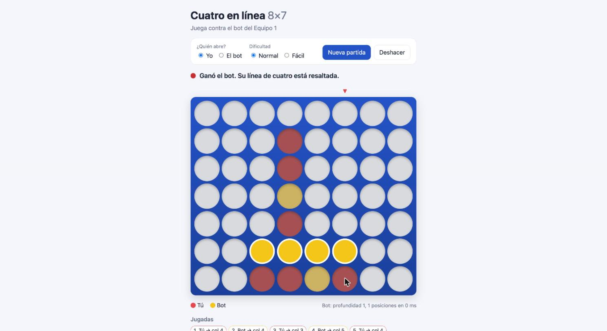

# Manual de usuario — Cuatro en línea 8×7

## ¿Qué es?
Es un juego de **Cuatro en línea** en el navegador, contra una computadora (el "bot"). El tablero tiene **8 columnas y 7 filas**. Por turnos, cada jugador deja caer una ficha en una columna; la ficha baja hasta el primer hueco libre.

**Gana quien junte 4 fichas de su color seguidas**: de lado, hacia arriba o en diagonal. Si el tablero se llena y nadie lo logró, es **empate**.

## Cómo abrir la aplicación
1. Pide a la persona que administra el bot que lo encienda. Esa persona usa el comando `npm run web` en su computadora.
2. Abre tu navegador (Chrome, Safari, Edge o Firefox).
3. Escribe la dirección:
   - En la misma computadora: **http://localhost:3000**
   - Desde un teléfono u otra computadora en la misma red wifi: **http://IP-de-la-computadora:3000**. La persona que administra el bot te dirá la IP.

## Cómo jugar
1. En **«¿Quién abre?»** elige **Yo** si quieres empezar, o **El bot** si quieres que empiece la computadora.
2. En **«Dificultad»** elige **Normal** (el bot piensa a fondo) o **Fácil** (el bot piensa poco y es más fácil de ganar).
3. Pulsa **Nueva partida**.
4. Cuando el mensaje diga **«Tu turno: elige una columna»**, haz clic (o toca con el dedo) cualquier casilla de la columna donde quieras jugar. La ficha cae sola hasta abajo.

   

5. El mensaje cambia a **«El bot está pensando…»** con un punto amarillo parpadeando. Espera unos 2 segundos: el bot pone su ficha y vuelve a ser tu turno.

   

6. Sigue así hasta que alguien gane o se llene el tablero.

## Qué significa cada elemento de la pantalla

| Elemento | Significado |
|---|---|
| 🔴 Ficha roja | Tus fichas |
| 🟡 Ficha amarilla | Fichas del bot |
| ▼ Flechas grises sobre el tablero | Columnas donde todavía puedes jugar. La flecha se pone roja en la columna donde está el ratón |
| Punto rojo junto al mensaje | Es tu turno |
| Punto amarillo parpadeando | El bot está pensando |
| Punto verde | Ganaste |
| Punto rojo oscuro | Ganó el bot |
| Fichas con borde blanco brillante | La línea de cuatro que ganó la partida |
| «Bot: profundidad 15, … posiciones en 1500 ms» | Cuántas jugadas hacia adelante imaginó el bot y cuántas posiciones revisó. Es solo informativo |
| **Jugadas** (abajo) | La lista de todas las jugadas de la partida, en orden |
| Botón **Deshacer** | Borra tu última jugada y la respuesta del bot, para que vuelvas a intentar |
| Botón **Nueva partida** | Empieza de cero con las opciones elegidas |

## Cómo termina una partida
- **Ganaste:** el mensaje dice «¡Ganaste!» y tus cuatro fichas brillan.
- **Ganó el bot:** el mensaje dice «Ganó el bot» y se resaltan sus cuatro fichas.

  

- **Empate:** el mensaje dice «Empate: el tablero se llenó sin ganador».

En los tres casos el tablero se bloquea. Pulsa **Nueva partida** para jugar otra.

## Preguntas frecuentes
**Hice clic y no pasó nada.** Revisa el mensaje de arriba del tablero: puede que el bot esté pensando, o que la partida ya haya terminado.

**Dice «La columna X está llena».** Esa columna ya tiene 7 fichas. Elige otra.

**Apareció un recuadro rojo «No se pudo contactar al bot».** El programa del bot se apagó o se perdió la conexión. Pide que lo vuelvan a encender y pulsa **Reintentar**.

**El bot siempre me gana.** Prueba la dificultad **Fácil**. Consejo: las columnas del centro son las más valiosas.
